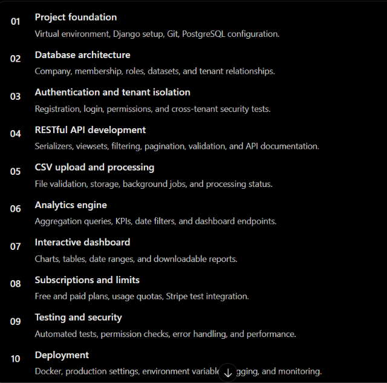

# Multi-Tenant-Saas-Analytics-Dashboard



<hr/>

### 1. Create & activate a virtual environment
```
mkdir saas-analytics
cd saas-analytics

py -m venv .venv
.venv\Scripts\Activate.ps1
```
<hr/>

### 2. Install the packages
`pip install -r requirements.txt`
<hr/>

`docker run -d --name saas-redis -p 6379:6379 redis:7`

```
docker start saas-redis
docker exec saas-redis redis-cli ping

```

`py -m celery -A config worker --loglevel=INFO --pool=solo`

<hr/>